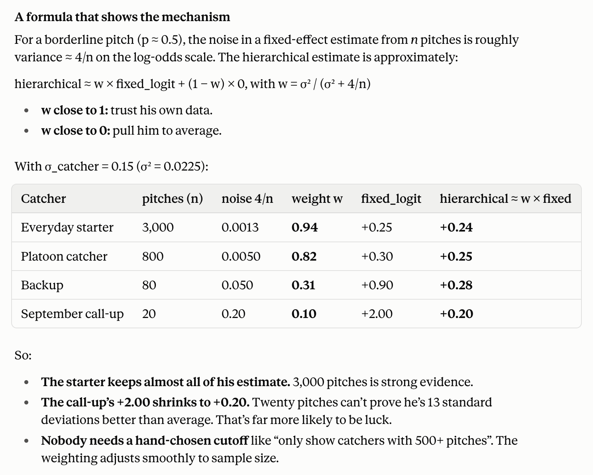

Catcher Framing

## 0.difficulty model(which looks only at location, count and handedness).  
pitch location, count, handedness(plate_x, z_norm, balls, strikes, lhb, lhp).   
**HistGradientBoostingClassifier**, trained on y (1 = called strike), out-of-fold by game.   
p_base   = probability an average catcher gets this pitch called a strike,e.g. 0.45
        
logit(p) = log(p / (1 − p)).    
offset = the same information on the log-odds scale, e.g. −0.20

used in both framing models:     
fixed:         P(strike) = sigmoid(offset + a)
hierarchical:  P(strike) = sigmoid(offset + b0 + catcher + pitcher + batter + umpire)


## 1.fixed-effect model

offset_i = logit(p_base_i).     

Expected strikes = sum of sigmoid(offset) over his pitches: what an average catcher would get.   
Actual strikes = sum of y: what he actually got.    

$$ sum(y − sigmoid(offset + a)) = 0 $$

a is a shift on the log-odds scale that applies to all his pitches: P(strike) = sigmoid(offset + a).      
- a = 0: he’s exactly average.
- a > 0: every pitch is a bit more likely to be called a strike with him catching.
- a < 0: less likely.

offset is one number per pitch, describing how hard that pitch is to get called a strike.
**a is one number per catcher (per season), the same for all his pitches. It soaks up everything that makes his pitches get called strikes more or less often than their difficulty predicts:**

- his real framing skill (what we want),
- the pitchers he caught: a staff with great command or deception gets more borderline strikes,
- the batters he faced and the umpires he worked with,
- luck: random variation

A starter with 3,000 pitches: luck mostly averages out, so a is mainly skill plus the pitcher/umpire mix.
A backup with 50 pitches: a is mostly luck. Ten lucky calls can make him look elite.

## 2.How partial pooling fixes this

The hierarchical model assumes each catcher’s true effect comes from a shared distribution:

catcher effect ~ Normal(0, σ_catcher)

Each catcher’s estimate is then a compromise between his own data and the league average (0), weighted by how much data he has.



Why σ being learned matters

How hard the model pulls is set by σ_catcher, and σ_catcher comes from the data:

If catchers really differ a lot (large σ), extreme values are plausible, so it shrinks less.
If catchers barely differ (small σ, maybe 2026 with the ABS challenges), it shrinks more, because a big estimate is probably noise.


### The second fix: adjusting for others at the same time
In the fixed model, a catcher whose staff has great command gets that credit inside his a. Here the pitchers’ effects absorb it, so the catcher effect is closer to his framing alone.

**Conclusion: shrinkage removes the luck, and the extra effects remove the context**


## 3.Result Comparison 
**fixed_logit** = a_c
     the a that solves:  sum over i in c of ( y_i − sigmoid(offset_i + a_c) ) = 0
     (actual strikes = predicted strikes; offset only, no b0 / pitcher / batter / umpire)

**hier_logit**  = mean over draws of  catcher_c  =  mean( sigma_catcher × z_catcher[c] )
     (estimated together with b0, pitcher, batter, umpire, with partial pooling)

**fixed_runs**  = sum over i in c of [ sigmoid(offset_i + a_c) − sigmoid(offset_i) ] × rps_i

**runs**        = mean over draws of
            sum over i in c of [ sigmoid(eta0_i + catcher_c) − sigmoid(eta0_i) ] × rps_i
     where eta0_i = offset_i + b0 + pitcher_{p(i)} + batter_{b(i)} + umpire_{u(i)}
     (b0 and the other effects at their posterior means)


sigma_catcher is one parameter per season.
The histogram shows many values because they’re posterior draws of that one parameter

## 4.Hierarchical structure

```text
Level 1 — league (one value per season)
    b0, sigma_catcher, sigma_pitcher, sigma_batter, sigma_umpire
              │  "how much do catchers differ in general?"
              ▼
Level 2 — individual players (one value per catcher / pitcher / batter / umpire)
    catcher_c ~ Normal(0, sigma_catcher)
    pitcher_p ~ Normal(0, sigma_pitcher)   ...
              │  "how good is this particular catcher?"
              ▼
Level 3 — individual pitches (one per borderline take)
    y_i ~ Bernoulli( sigmoid(offset_i + b0 + catcher_c + pitcher_p + batter_b + umpire_u) )
              "was this pitch called a strike?"
```


### sigmoid and logit
logit = log(p/(1-p))
sigmoid = 1/1+exp(-x)